<p align="center">
  
</p>

# SyncPK: Two-Way Kodi & Plex Sync Server

[](LICENSE)

SyncPK is a self-hosted, lightweight two-way synchronization tool designed to keep your **Kodi** and **Plex** watch history perfectly aligned. 

Whether you watch a movie on your TV using Kodi or catch up on a series on your phone using Plex, SyncPK ensures both platforms instantly reflect the watched status without infinite synchronization loops.

<p align="center">
  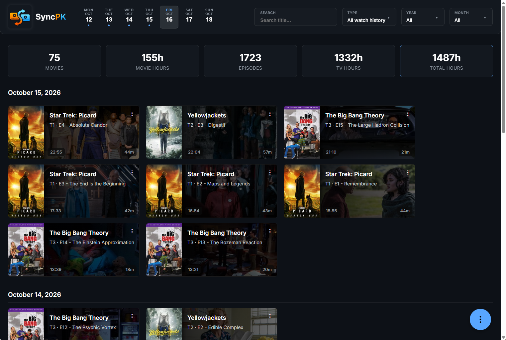
</p>

## 💡 Why SyncPK?

For years, keeping your watch history synchronized between **Kodi** and **Plex** meant relying on third-party cloud platforms like **Trakt.tv**. But cloud trackers come with significant friction:

- 💸 **Subscription Paywalls:** Achieving true, seamless bi-directional synchronization between media centers has increasingly been locked behind recurring monthly or annual VIP subscriptions.
- 📉 **Unpredictable Policy Changes:** Third-party cloud services frequently alter their criteria, API rate limits, and feature availability without notice.
- ☁️ **Cloud Dependency & Privacy:** Your personal viewing history and media habits reside on external servers, leaving you vulnerable to outages, rate limits, and cloud privacy concerns.

### 🛡️ Local Freedom & True Ownership
SyncPK was created to eliminate these compromises completely:
- **100% Self-Hosted & Local:** Runs on your own hardware (Proxmox LXC, Docker, Raspberry Pi, or any baremetal Linux server).
- **Two-Way Sync for Life:** Instant, automated bidirectional synchronization between your Kodi media center and Plex library without a single cent in subscription fees.
- **Yours Forever:** You never have to worry about third-party criteria changes, sudden paywalls, or feature tiering. Because SyncPK is deployed locally on your own infrastructure, **it is yours forever**.
- **Complete Privacy:** Your watch history, database, and cached artwork stay strictly inside your own home network.

## ✨ Key Features

- 🔄 **Real-Time Two-Way Sync:** Instant synchronization between Kodi and Plex with loop prevention.
- 📅 **Batch Date Editing & Advanced Scopes:** Change watch dates per episode, season, or entire series with smart distribution (fixed, random, or between dates).
- 🎨 **Modern Dark Web UI:** High-performance dashboard with watch metrics, calendar filtering, and local TMDB poster caching.
- ⚙️ **Automated Webhooks & Background Polling:** Instant webhooks with automatic background fallback polling for Plex Pass and non-Plex Pass setups.
- 🌐 **Multilingual Support:** Fully localized in 8 languages (English, Spanish, German, French, Italian, Portuguese, Chinese, Japanese).

<p align="center">
  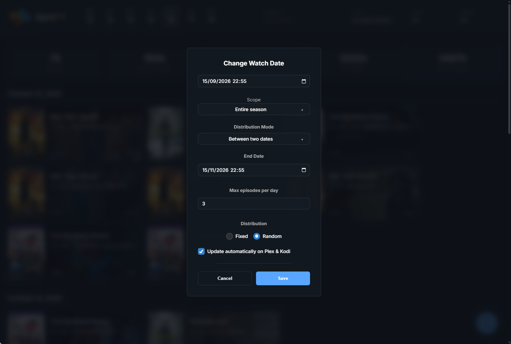
  &nbsp;
  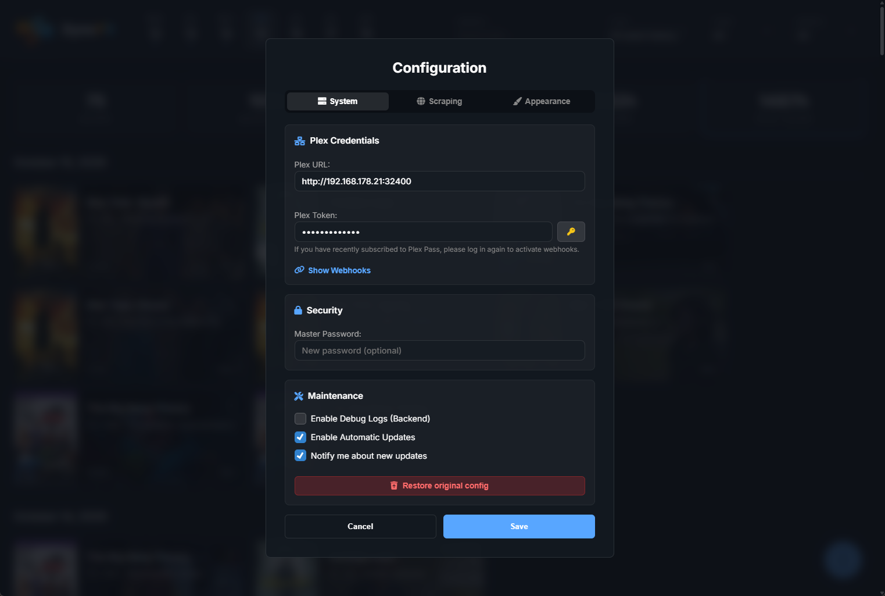
</p>

## 🚀 How it works

The project is divided into two main components:
1. **Central Server (`main.py`)**: A lightweight, robust FastAPI server that acts as a broker and background worker. It receives webhooks from Kodi and Plex when you watch something, storing a unified watch history in a local SQLite database. It also features a built-in **Plex background syncer** that periodically asks Plex for its latest watch history, a **Full Library historical importer**, and an asynchronous **TMDB Image Cacher** that downloads highly optimized posters to your local drive for zero-latency dashboard rendering.
2. **Kodi Addon**: A Kodi plugin that tracks your local playback and pushes it to the server via Webhooks, while also pulling the latest changes from the server on startup or periodically.

Everything is secured by **scrypt** and **Plex PIN OAuth** for a seamless and secure login experience.

---

## 🔑 Prerequisites (Tokens & API Keys)

Before installing, you will need two things:

### 1. Plex Account (OAuth)
The setup uses a secure OAuth flow to connect with your Plex server. During the web setup, you will be prompted to log in to Plex via a secure PIN link. You simply visit that link, authorize SyncPK, and the setup will securely configure your server automatically.

### 2. TMDB API Key
This is required to fetch movie/show posters and durations for your dashboard.
1. Create a free account at [The Movie Database (TMDB)](https://www.themoviedb.org/).
2. Go to your Account Settings -> API.
3. Request an API Key (Developer). It's instant and free. You'll get a 32-character string.

---

## 🛠️ Installation

SyncPK requires Linux with `systemd` (for baremetal/LXC) and Python 3.10+. We support `amd64` and `arm64` architectures.
Supported Linux distributions: **Debian 12+**, **Ubuntu 22.04+**, **Raspberry Pi OS (64-bit, Bookworm recommended)**, **Fedora 38+**, **AlmaLinux / Rocky / RHEL 9+**, and **Arch Linux**.

We provide multiple installation options. The initial installation is very quick, and once it finishes, you will complete the configuration (Plex Auth, TMDB, passwords) through a beautiful Web UI.

### Option A: Proxmox Automatic LXC
If you are running a Proxmox server, you can use our interactive script to automatically create a brand-new LXC container, install all dependencies, and set up the services. Run this command directly in your **Proxmox Host Shell**:

```bash
bash -c "$(curl -fsSL https://github.com/lechtung/SyncPK/releases/latest/download/install_proxmox.sh)"
```

**Next step:** Open your browser and go to `http://<YOUR_LXC_IP>:8000` to start the Web Setup.

> ⚠️ **Note about DHCP:** If you rely on DHCP for the LXC container's IP, create a **DHCP reservation** in your router so the IP doesn't change and break your Kodi/Plex webhook URLs.

<p align="center">
  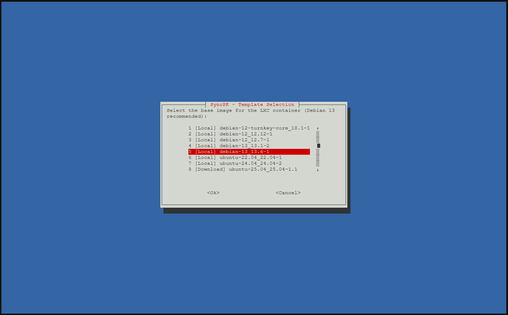
  &nbsp;
  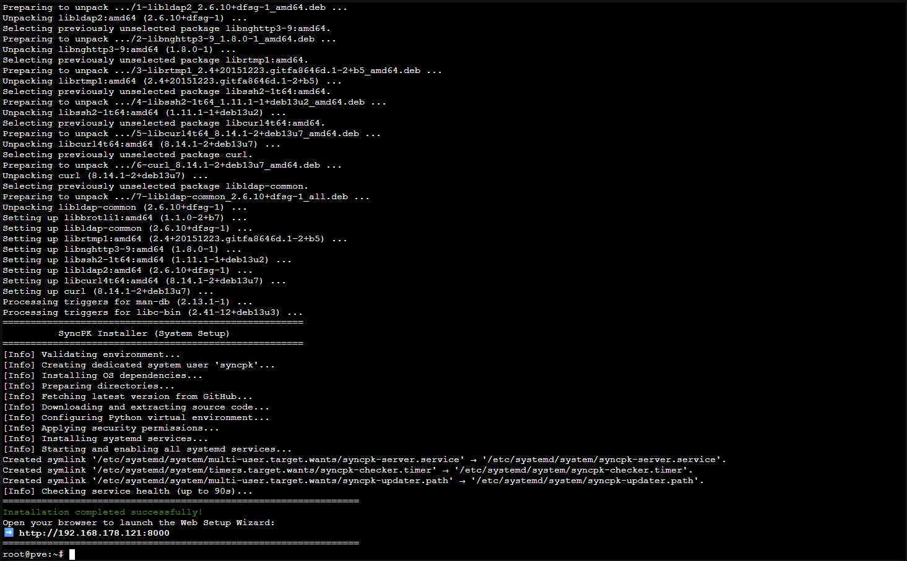
</p>

### Option B: Baremetal / Existing Linux Machine
If you want to install SyncPK on a Raspberry Pi, an existing Linux server, or inside a container you already created, use this script. Run this command as **root** inside your Linux machine:

```bash
bash -c "$(curl -fsSL https://github.com/lechtung/SyncPK/releases/latest/download/install.sh)"
```

**To reinstall** (overwriting an existing installation safely):
```bash
bash -c "$(curl -fsSL https://github.com/lechtung/SyncPK/releases/latest/download/install.sh)" _ --force
```

*(Optional)* To manually verify download integrity prior to running, releases provide a `checksums.sha256` file:
```bash
curl -fsSLO https://github.com/lechtung/SyncPK/releases/latest/download/checksums.sha256 \
  && curl -fsSLO https://github.com/lechtung/SyncPK/releases/latest/download/install.sh \
  && sha256sum -c checksums.sha256 --ignore-missing \
  && sudo bash install.sh
```

**Next step:** Open your browser and go to `http://<YOUR_SERVER_IP>:8000` to start the Web Setup.

### Option C: Docker Compose (r/selfhosted)
For the standard self-hosted stack, SyncPK can be deployed seamlessly using Docker. We provide a pre-built image hosted on GitHub Container Registry (GHCR).

1. Create a `docker-compose.yml` file (or paste this into Portainer / Dockge):
   ```yaml
   services:
     syncpk-server:
       image: ghcr.io/lechtung/syncpk:latest
       container_name: syncpk-server
       restart: unless-stopped
       environment:
         # Set your local timezone (e.g. Europe/Madrid, America/New_York, UTC)
         - TZ=Etc/UTC
         # - PUID=1000 # Uncomment if running on a NAS (e.g. Synology, Unraid)
         # - PGID=1000
       ports:
         - "8000:8000"
       volumes:
         - ./data:/app/data
   ```

   > 💡 **Portainer / Dockge Note:** When using web managers like Portainer, relative paths like `./data` are stored in the engine's internal stack folder. If you prefer to store data in a specific host path, replace `./data` with an absolute path (e.g. `/opt/syncpk-data:/app/data`).

   *(Alternatively, download the compose file directly via terminal)*:
   ```bash
   curl -fsSL -O https://raw.githubusercontent.com/lechtung/SyncPK/main/docker-compose.yml
   ```

2. Start the container:
   ```bash
   docker compose up -d
   ```
3. **Next step:** Open your browser and go to `http://<YOUR_SERVER_IP>:8000` to start the Web Setup.
   - If you need to check your server's local IP address, run:
     ```bash
     hostname -I | awk '{print $1}'
     ```
   - The Web Setup Wizard and Dashboard will be available at `http://<YOUR_SERVER_IP>:8000` (unless you modified the host port mapping in `docker-compose.yml`).

> ⚠️ **Proxmox Note (Option A Recommended):** On Proxmox, we strongly recommend using the **Native LXC installer (Option A)** instead of nested Docker. If you specifically need Docker inside an **unprivileged LXC container**, AppArmor may block the container runtime (`runc: open sysctl net.ipv4.ip_unprivileged_port_start: permission denied`).
> 
> *Security notice:* Disabling AppArmor (`unconfined`) reduces container isolation. For full isolation with Docker, consider using a standard VM instead. If you proceed with LXC:
> - The configuration line must be placed in the header of `/etc/pve/lxc/<CTID>.conf` before any `[snapshot]` blocks (using `>>` on a container with snapshots would append inside the snapshot section and be ignored):
> ```bash
> sed -i '1i lxc.apparmor.profile: unconfined' /etc/pve/lxc/<CTID>.conf && pct reboot <CTID>
> ```

#### 🪟 Windows Users (Docker Desktop / Podman)
Running SyncPK natively as a Windows service is not officially supported. However, you can run it seamlessly using **Docker Desktop** (with WSL2 backend).

1. **Download compose file in PowerShell**:
   In PowerShell, invoke `curl.exe` directly (as `curl` is a PowerShell alias):
   ```powershell
   curl.exe -fsSL -O https://raw.githubusercontent.com/lechtung/SyncPK/main/docker-compose.yml
   ```

2. **Recommended Storage (Named Volume)**:
   SyncPK uses SQLite in WAL mode. Due to filesystem locking limitations between Windows NTFS and WSL2 bind mounts, we **strongly recommend** using a Docker Named Volume instead of mapping a local Windows folder. This guarantees maximum performance and eliminates database lock errors:

   ```yaml
   services:
     syncpk-server:
       image: ghcr.io/lechtung/syncpk:latest
       container_name: syncpk-server
       restart: unless-stopped
       environment:
         - TZ=UTC # Change to your local timezone (e.g. America/New_York, Europe/Madrid)
       ports:
         - "8000:8000"
       volumes:
         - syncpk-data:/app/data

   volumes:
     syncpk-data:
   ```

---

## 🧙‍♂️ Web Setup Wizard & Initial Import

Once installed, open `http://<YOUR_SERVER_IP>:8000` in your browser. SyncPK guides you through a seamless 9-step configuration wizard and imports your historical library activity automatically:

<p align="center">
  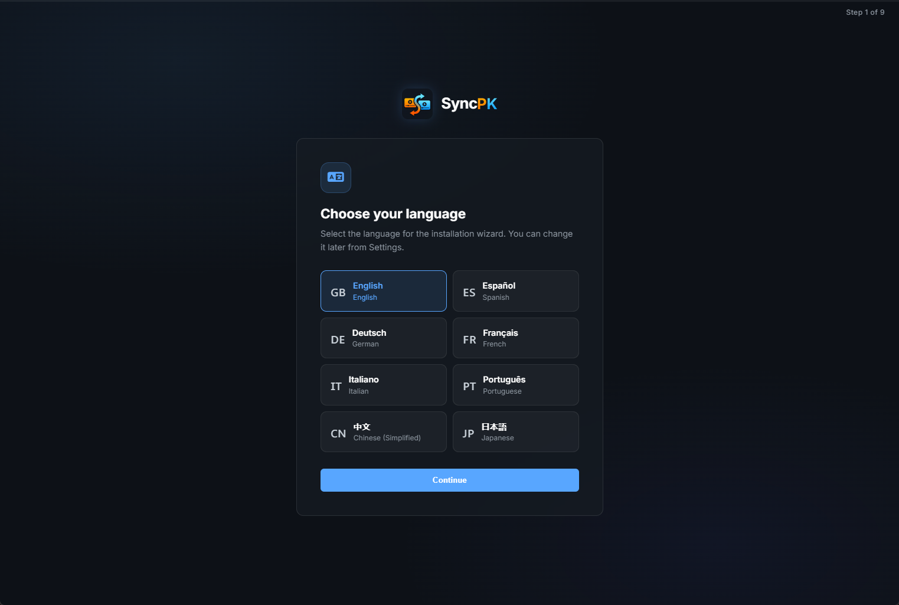
  &nbsp;
  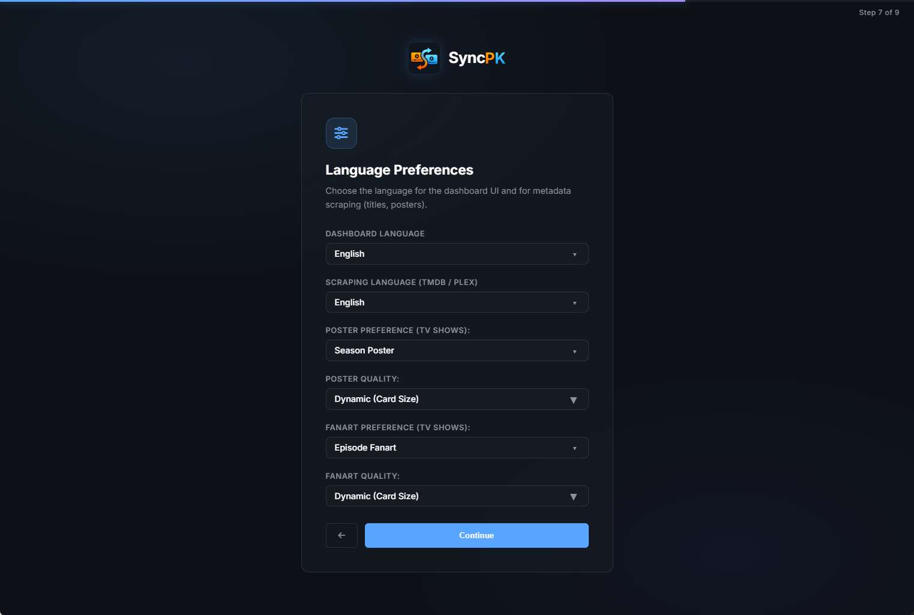
  &nbsp;
  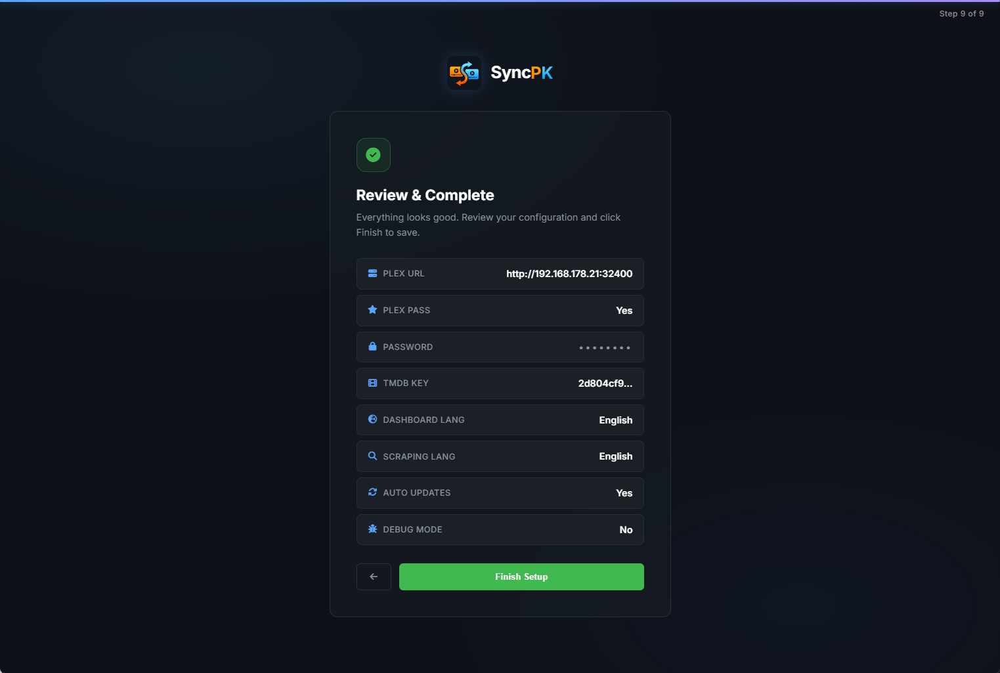
</p>

During the first run, SyncPK scans your library, syncs cloud activity, and caches high-resolution artwork:

<p align="center">
  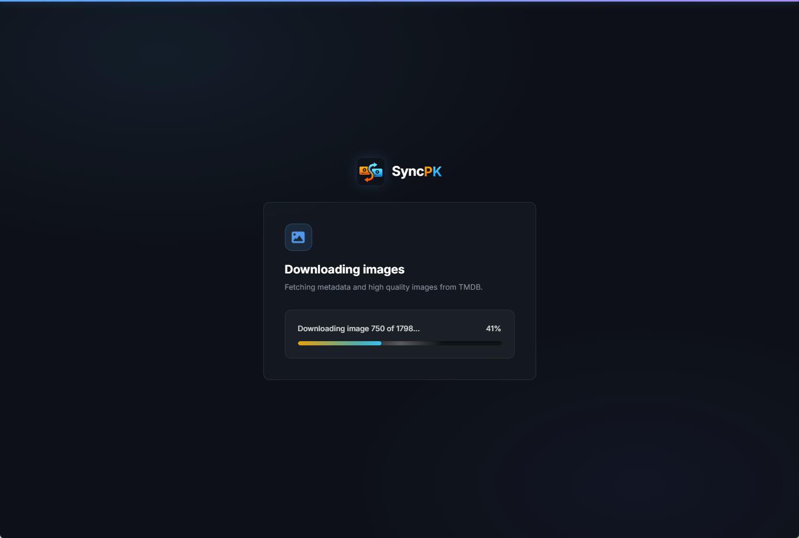
  &nbsp;
  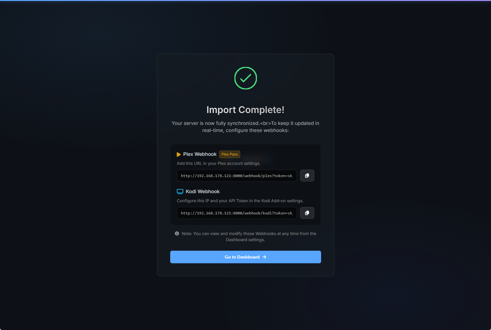
</p>

<details>
<summary>📸 <b>Click to expand full screenshots gallery (All 19 screens)</b></summary>
<br>

### 🖥️ Dashboard & Modals
| General Dashboard | Batch Date Editing | Delete Modal | Settings Modal |
|:---:|:---:|:---:|:---:|
| [](screenshots/dashboard_general.png) | [](screenshots/dashboard_change_date.png) | [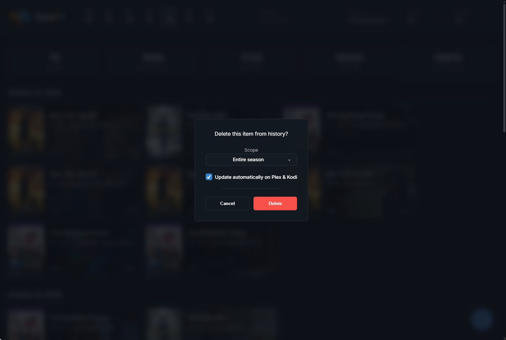](screenshots/dashboard_delete.png) | [](screenshots/dashboard_config.png) |

### 🛠️ Proxmox LXC Automated Installer
| Template Selection | Installation Success |
|:---:|:---:|
| [](screenshots/proxmox_install.png) | [](screenshots/proxmox_finish.png) |

### 🧙 Complete Setup Wizard (Steps 1–9)
| Step 1: Language | Step 2: Plex URL | Step 3: Plex Auth |
|:---:|:---:|:---:|
| [](screenshots/setup_language.png) | [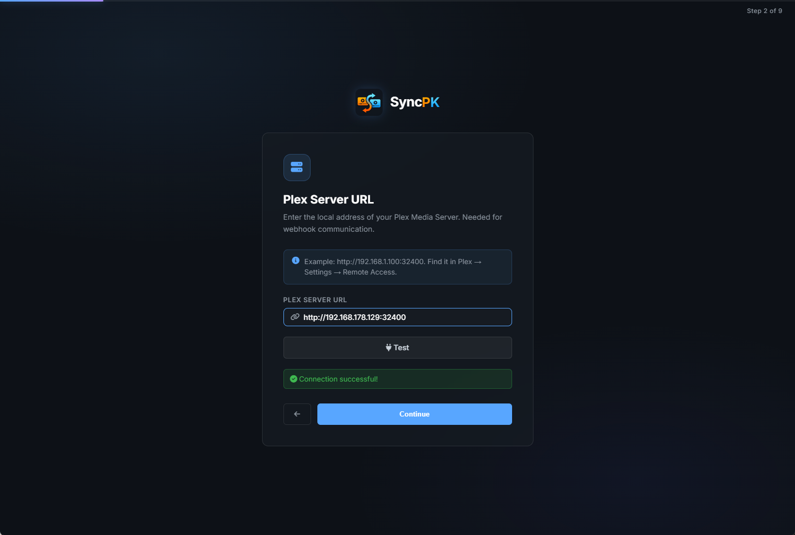](screenshots/setup_plex_ip.png) | [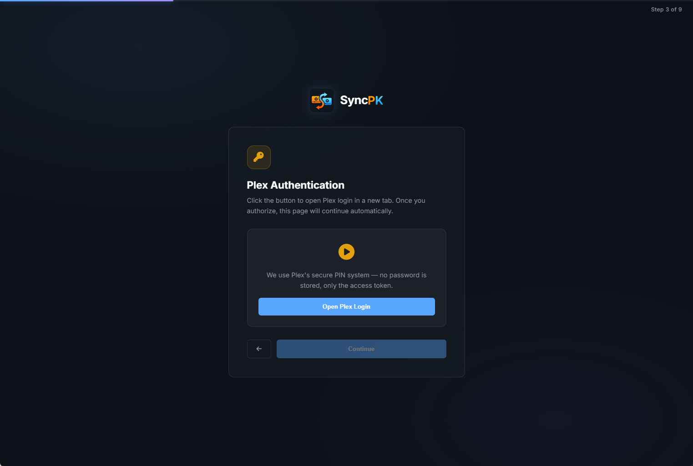](screenshots/setup_plex_login.png) |
| **Step 4: Plex Pass** | **Step 5: Password** | **Step 6: TMDB Key** |
| [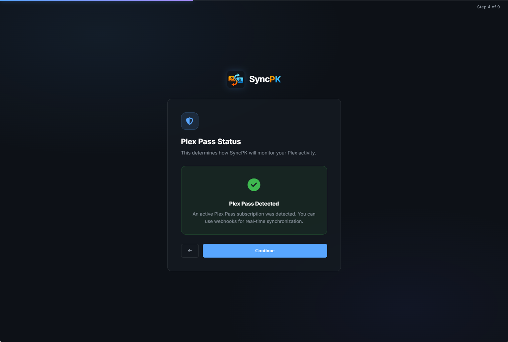](screenshots/setup_plex_pass.png) | [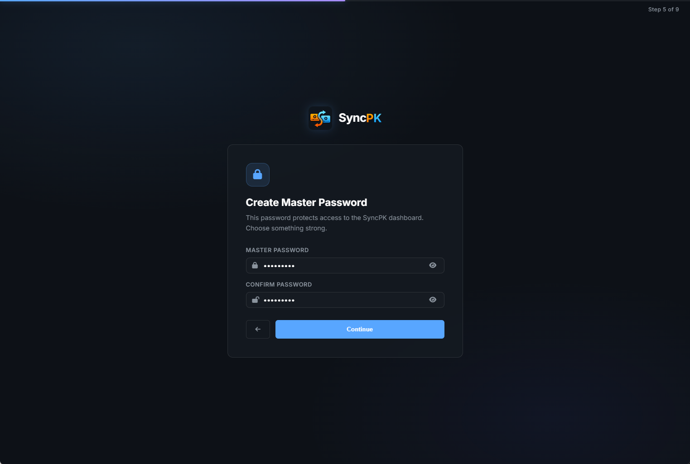](screenshots/setup_password.png) | [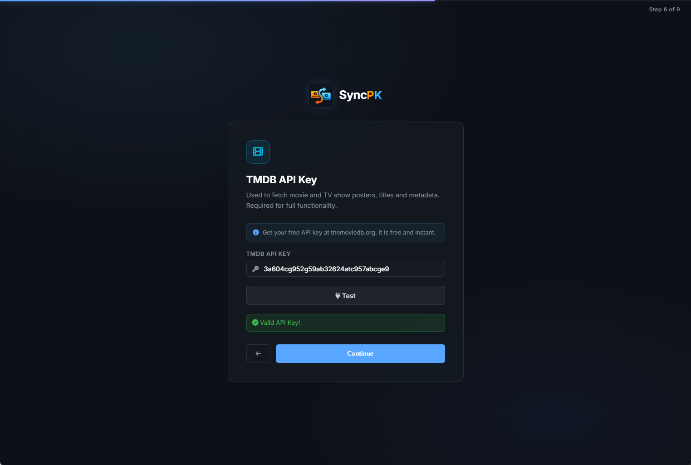](screenshots/setup_tmdb_key.png) |
| **Step 7: Preferences** | **Step 8: Updates** | **Step 9: Review** |
| [](screenshots/setup_preferences.png) | [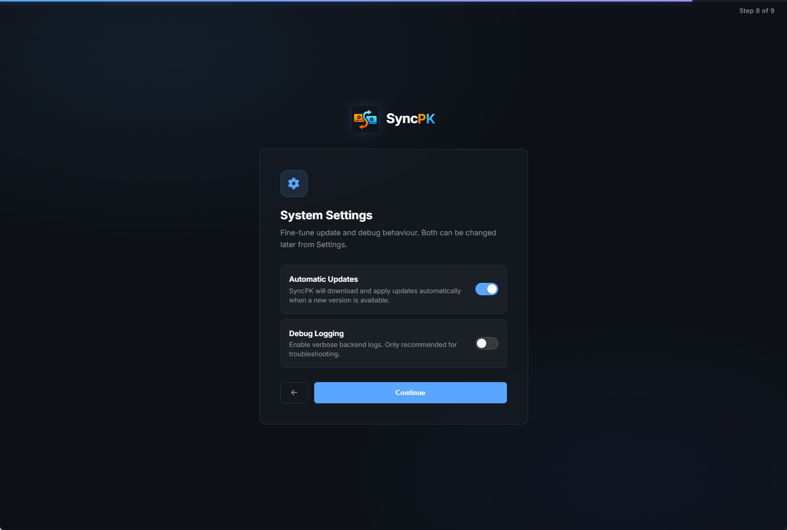](screenshots/setup_updates.png) | [](screenshots/setup_review.png) |

### 📥 Initial Library Import Flow
| Local Activity Scan | Cloud Activity Sync | Artwork Caching | Import Finished |
|:---:|:---:|:---:|:---:|
| [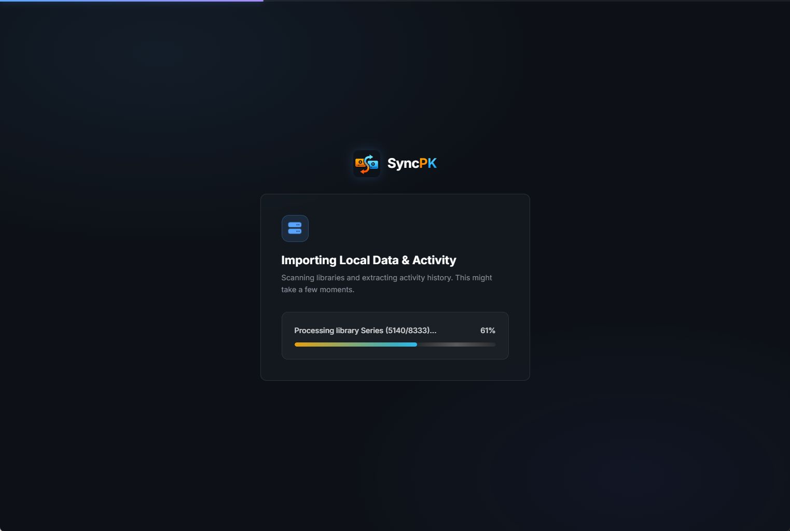](screenshots/import_local.png) | [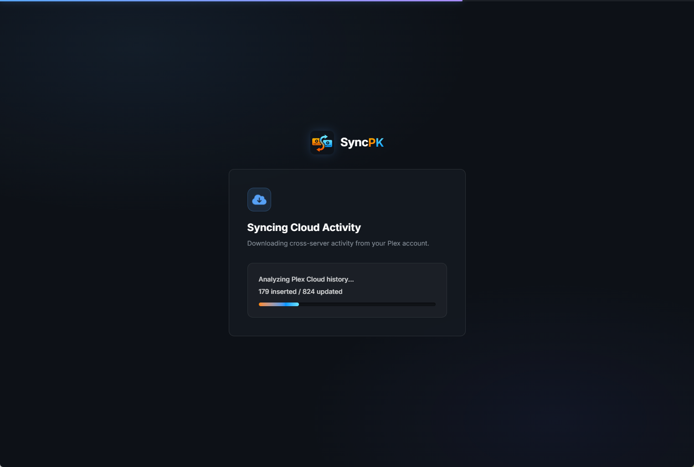](screenshots/import_cloud.png) | [](screenshots/import_pictures.png) | [](screenshots/import_complete.png) |

</details>

---

## 🎬 Plex Webhook Setup

For SyncPK to know immediately when you watch something on Plex, you need to configure a webhook in your Plex server:

1. Open your Plex Web interface and go to **Account Settings**.
2. Scroll down the left menu and click on **Webhooks**.
3. Click **Add Webhook**.
4. Enter your SyncPK server webhook URL. **You can find your exact URL with your secure token at the end of the Web Setup wizard or in the SyncPK Dashboard settings.**
5. Click **Save Changes**.

*(Note: Plex Webhooks require an active Plex Pass subscription. If you do not have Plex Pass, the integrated background task in the server will still poll Plex periodically to get your watches, but the webhook allows for instant sync without delays).*

---

## 📺 Kodi Addon Setup

Once the server is running, you need to install the Kodi addon on your media players.

1. Download [`kodi_addon.zip`](https://github.com/lechtung/SyncPK/releases/latest/download/kodi_addon.zip) from the latest GitHub Release and install it in Kodi via "Install from zip file".
2. Go to the Addon Settings.
3. In the **SyncPK Server** tab, configure:
   - **Webhook URL**: Copy the Kodi Webhook URL provided at the end of the Web Setup wizard or in the SyncPK Dashboard settings (it includes your secure API token).
4. Restart Kodi. It will automatically perform a full sync!

---

## 🔄 Updates & Maintenance

- **UI Auto-Update**: If you enabled auto-updates in the Web Setup (Baremetal/LXC), the server updates itself automatically via systemd timer.
- **Manual Baremetal Update**: If auto-update is disabled, run `sudo /opt/syncpk/update.sh`.
- **Docker Updates**: Run `docker compose pull && docker compose up -d`.
- **Rollback Application Code**: During an update, SyncPK preserves the previous working application release in `/opt/syncpk.prev`. If an update causes an unexpected issue, you can immediately revert to the previous code version:
  ```bash
  sudo systemctl stop syncpk-server
  sudo rm -rf /opt/syncpk && sudo mv /opt/syncpk.prev /opt/syncpk
  sudo install -m 644 /opt/syncpk/systemd/* /etc/systemd/system/ && sudo systemctl daemon-reload
  sudo systemctl start syncpk-server
  ```
  *(Note: In Proxmox LXC or when running directly as root, omit 'sudo' as commands already run with root privileges)*.

  > 💡 **Important Rollback Notes:**
  > - `/opt/syncpk.prev` is temporary and gets overwritten during the next update execution.
  > - If the update introduced database schema migrations, you must also restore the database backup created before the update from `/var/backups/syncpk/` (see Restore section below).
  > - If automatic updates are enabled, temporarily disable them or configure the version in dashboard settings to prevent the scheduled updater from immediately upgrading again.
- **View Logs**: To troubleshoot, run `journalctl -u syncpk-server -f` (Baremetal/LXC) or `docker compose logs -f` (Docker).
- **Custom Port/Host (Baremetal)**: To change the listening port or IP, create a systemd drop-in override:
  ```bash
  sudo systemctl edit syncpk-server
  ```
  Add the following lines (replacing 8080 with your desired port):
  ```ini
  [Service]
  ExecStart=
  ExecStart=/opt/syncpk/venv/bin/python3 -m uvicorn main:app --host 0.0.0.0 --port 8080 --no-access-log
  ```
  Then reload and restart: `sudo systemctl restart syncpk-server`.

  > ⚠️ **Note on systemd overrides:** The drop-in replaces the entire `ExecStart=` directive. SyncPK's updater automatically detects your overridden port to perform health checks and rollbacks reliably.

---

## 🔒 Security & Firewall

**Important:** SyncPK runs entirely over HTTP and tokens are passed in the URL. **DO NOT** expose port 8000 directly to the Internet. If you need external access, use a secure Reverse Proxy (like NGINX, Traefik, or Cloudflare Tunnels) with SSL/TLS termination.

If your server has an active firewall, allow connections to port 8000 from your local network:

```bash
# For UFW (Ubuntu / Debian / Raspberry Pi OS):
sudo ufw allow from 192.168.0.0/16 to any port 8000 proto tcp
# Or to allow unconditionally on a trusted local network:
# sudo ufw allow 8000/tcp

# For firewalld (AlmaLinux / Rocky / Fedora / RHEL):
# sudo firewall-cmd --add-port=8000/tcp --permanent && sudo firewall-cmd --reload
```

> ⚠️ **Docker & UFW:** If you expose port `8000:8000` in Docker, it will **bypass UFW**. To strictly bind the server to localhost for a reverse proxy, use `127.0.0.1:8000:8000` in your compose file.

---

## 💾 Backup & Restore

All your configuration, hashed passwords, and the synchronized watch history are securely stored in `/var/lib/syncpk`.

> ⚠️ **Filesystem Compatibility:** SyncPK uses SQLite in WAL mode. **Do not** locate `/var/lib/syncpk` or your Docker data directory on network storage like NFS or SMB/CIFS, as network filesystem locking limitations can cause database corruption.

**Backup:**
To guarantee database consistency without locking errors, stop the service before creating a compressed archive:
```bash
sudo systemctl stop syncpk-server
sudo install -d -m 700 /var/backups/syncpk
(umask 077 && sudo tar -czf /var/backups/syncpk/manual_backup_$(date +%Y%m%d_%H%M%S).tar.gz --exclude="./cache" -C /var/lib/syncpk .)
sudo systemctl start syncpk-server
```
*(Note: In Proxmox LXC or when running directly as root, omit 'sudo')*  
*(For Docker, simply backup your mapped `./data` directory or named volume).*

> 💡 **Automated Backups:** The updater (`update.sh`) automatically takes a verified compressed backup before every update in `/var/backups/syncpk/syncpk_data_backup_*.tar.gz`, retaining the latest 3 copies.

**Restore:**
Restore the archive into `/var/lib/syncpk` and ensure ownership before starting the service:
```bash
sudo systemctl stop syncpk-server
sudo find /var/lib/syncpk -mindepth 1 -maxdepth 1 ! -name 'cache' -exec rm -rf {} +
sudo tar -xzf /var/backups/syncpk/YOUR_BACKUP_FILE.tar.gz -C /var/lib/syncpk
sudo chown -R syncpk:syncpk /var/lib/syncpk
sudo systemctl start syncpk-server
```

---

## 🗑️ Uninstallation

**Warning:** Uninstalling will permanently delete your application files.

**For Proxmox LXC**: Destroy the container from your Proxmox web interface.

**For Baremetal**:
```bash
sudo /opt/syncpk/uninstall.sh
```
To also purge all data and backups non-interactively:
```bash
sudo /opt/syncpk/uninstall.sh --purge -y
```

**For Docker**: Run `docker compose down` and delete the persistent folder or volume:
```bash
docker compose down -v
rm -rf data
```

---

## 🌍 Localization & Contributing Translations

SyncPK currently supports **8 languages**: English, Spanish, German, French, Italian, Portuguese, Japanese, and Chinese.

> 💡 **Drop-in Language Architecture:**  
> SyncPK uses a completely decoupled JSON localization system. When the Dashboard Language is set to **Browser Default** (`DASHBOARD_LANGUAGE="auto"`), SyncPK detects the visitor's browser language code (e.g. `nl` for Dutch, `pl` for Polish) and automatically attempts to load `server/static/locales/<lang_code>.json`.  
> This means **anyone can add a brand-new language without touching a single line of Python or JavaScript source code**—simply create `<lang_code>.json` inside [`server/static/locales/`](server/static/locales/) using [`en.json`](server/static/locales/en.json) as a template!

> ℹ️ **AI Translation Note & Community Contributions:**  
> The localization files for languages other than Spanish and English were initially generated with the help of AI. While they provide comprehensive coverage, some phrases or nuances might not be 100% accurate.  
> 
> If you are a native speaker of any of these languages (or would like to contribute a new language!), **contributions are warmly welcome!**  
> Feel free to review or add locale files in [`server/static/locales/`](server/static/locales/) and open a Pull Request.

---

## 🙏 Credits & Third-Party Libraries

SyncPK uses the following open-source libraries:

- **[Pickr](https://github.com/Simonwep/pickr)** by Simonwep: A flat, simple, and elegant color-picker used in the dashboard's appearance configuration.

**Disclaimer:** This product uses the TMDB API but is not endorsed or certified by TMDB. SyncPK is not affiliated with, endorsed by, or sponsored by Plex Inc. or the XBMC Foundation (Kodi).

---

## 📄 License

This project is licensed under the GNU General Public License v3.0 (GPL-3.0). See the [LICENSE](LICENSE) file for details.
